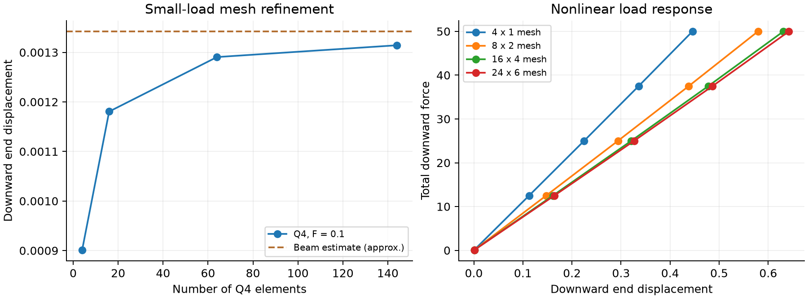
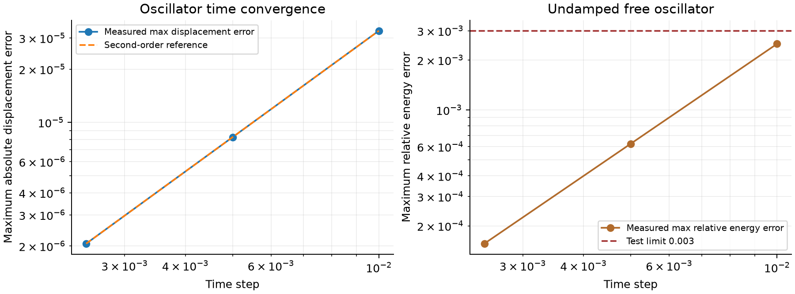

# NonlinearFEM 算例手册

源码工作版初稿，2026-11-20。本版提供六个冻结的解析输入算例和四组复用既有验证程序的算例，共十组。它们构成项目内的标准验证集初版；尚不构成完整的三维工程软件验证体系。

每组给出目的、模型或源码入口、边界与载荷、参考解、运行方法和通过条件。基准结果来自实际运行，不是手填的预期输出。

## 1 复现与记录

### 1.1 一次运行完整标准集

从项目根目录执行：

```powershell
cmake -S . -B build
cmake --build build
python tools/run_standard_cases.py --build-dir build
```

多配置构建先用 `cmake --build build --config Debug`，随后指定 `--build-dir build/Debug`。标准脚本需要 Python；只使用标准库及仓库中的后处理模块，不需要额外 Python 包。

默认输出到全新的 `results/standard_时间戳`。也可指定一个尚不存在的目录：

```powershell
python tools/run_standard_cases.py --build-dir build --output results/standard_check
```

输出包括总表 REPORT.md、机器可读 report.json、求解程序与相关源码 SHA256、各算例日志、解析类输入快照与数值 CSV。报告中的 PASS 对应脚本判据或既有验证程序的非零退出规则；一组失败不会把其他组的记录丢掉，总退出状态仍为失败。

脚本不修改求解器，不覆盖旧报告，不自动更新本手册的基准附件。修改程序后应生成新报告，再判断是否替换归档基准。

### 1.2 输入与参考值

六个 `.nfem` 文件位于 [examples/standard](../examples/standard/)，[cases.json](../examples/standard/cases.json) 保存冻结的节点位移参考值、应变、第二 PK 应力和容差。参考值由下述闭式关系生成，不采用同一次数值计算的结果作为参考。

其他四组直接复用既有 C++ 验证程序；完整几何、参数和判据保存在对应源码中，并由统一脚本保存日志，不另写重复测试实现。

### 1.3 解析输入类的统一误差定义

位移误差为所有节点、所有分量的最大绝对误差，要求 ≤1e-7。这里模型参考长度均为 1；如果另行更换单位或尺寸，应重新审定绝对位移容差，不能机械沿用。

应变误差以 max(1,参考应变分量的最大绝对值) 为尺度；应力误差以 max(Y,参考应力分量的最大绝对值) 为尺度。遍历各单元，取两类归一化误差的最大值，要求 ≤1e-7。这样接近零的应力分量不会被“除以接近零的参考值”放大，也不依赖人为选定一个无量纲的 1 来代表应力单位。

反力平衡误差为各方向 `|Σ反力+总节点外力|` 的最大值。拉伸类要求 ≤max(1,总力绝对值)×1e-7；其他类总节点外力为零，要求 ≤1e-7。刚体运动还额外要求每个反力分量的绝对值 ≤1e-7。

场量比较使用 [contour_fields.py](../gui/contour_fields.py) 从求解后的位移恢复结果；它是输出一致性与闭式场量检查。反力来自 C++ 求解器输出。对于完全指定位移的算例，位移本身没有自由未知量，不能把其位移误差为零当作 Newton 求解精度证明。

## 2 算例总表

| ID | 模型 | 验证重点 | 本轮结论 |
| --- | --- | --- | --- |
| Q4_rotation | 单位正方形，2×2 Q4 | 有限刚体转动和平移，零应变、零应力、零反力 | PASS |
| H8_rotation | 单位立方体，2×1×1 H8 | 三维刚体运动与节点顺序接入 | PASS |
| Q4_tension | 单位正方形，2×2 Q4，t=0.2 | 有限拉伸、自由侧向收缩、力平衡 | PASS |
| H8_tension | 单位立方体，2×1×1 H8 | 三维有限拉伸、两侧向收缩、力平衡 | PASS |
| Q4_shear | 单位正方形，2×2 Q4，t=0.2 | 仿射剪切及工程剪应变约定 | PASS |
| H8_shear | 单位立方体，2×1×1 H8 | 三维仿射剪切、第二 PK 分量 | PASS |
| Q4_patch | 规则与畸变四单元 patch | 自由中心节点、运动学、应力、单元力与平衡 | PASS |
| Q4_tangent | 规则与畸变网格 | 内力差分与解析切线、对称性 | PASS |
| Q4_cantilever_refinement | 四级网格、五级端部力 | 非线性弯曲、平衡、网格加密与近似梁解 | PASS |
| oscillator_time_refinement | 单自由度弹簧质量系统 | 时间精度、能量与二阶收敛 | PASS |

本轮完整证据见 [归档实测报告](verification/2026-11-20/REPORT.md)。补充的基础回归检查仍通过 `ctest --test-dir build --output-on-failure` 运行，本套脚本没有代替 CTest。

## 3 有限刚体运动

### 3.1 模型与输入

[Q4_rotation.nfem](../examples/standard/Q4_rotation.nfem)：Y=1000、ν=0.3、t=0.2，单位正方形，9 节点、4 单元。

[H8_rotation.nfem](../examples/standard/H8_rotation.nfem)：Y=1000、ν=0.3，单位立方体，12 节点、2 单元，采用本项目 H8 局部顺序。

旋转角 θ=0.6 rad，绕 Z 轴旋转。平移量二维为 (0.2,-0.1)，三维为 (0.2,-0.1,0.3)。所有节点各方向均给定 u=(R−I)X+c，不施加节点力。

### 3.2 参考与执行

参考解为 F=R，E=0，S=0，内力与反力为零。程序比例加载的中间步不一定是刚体转动，本算例比较的是最终 α=1 构形。

```powershell
build\NonlinearFEM.exe examples\standard\Q4_rotation.nfem results\check_q4_rotation
build\NonlinearFEM.exe --h8 examples\standard\H8_rotation.nfem results\check_h8_rotation
```

通过条件采用第 1.3 节的统一判据，额外检查峰值反力。重点是有限转动客观性与输出链路，不是自由节点求解或弯曲精度。

## 4 自由侧向收缩的有限拉伸

### 4.1 闭式参考解

定义轴向伸长比 λx，Exx=(λx²−1)/2。对于这里采用的各向同性 StVK 关系和自由侧向第二 PK 应力，侧向应变为 Eyy=−νExx；H8 还有 Ezz=−νExx。

\[
\lambda_y=\lambda_z=\sqrt{1-2\nu E_{xx}},\qquad
S_{xx}=Y E_{xx},\qquad P_{xx}=\lambda_xS_{xx}.
\]

Q4 只使用 λy。位移为 ux=(λx−1)X，uy=(λy−1)Y，三维再加 uz=(λz−1)Z。输入是作用于参考边/面的节点力，合力为 Pxx×参考面积，不是变形后面积上的随动力。

### 4.2 Q4_tension

[输入文件](../examples/standard/Q4_tension.nfem)。单位正方形、2×2 单元、Y=210000、ν=0.3、t=0.2。左边 ux=0，左下角 uy=0，上下边自由；右边节点水平力按端点 1/4、中点 1/2 分配。

取 λx=1.2，Exx=0.22，Eyy=−0.066，Sxx=46200，右边总力=11088，右端 ux=0.2。其余面内应力应为零。

这包含 14 个自由自由度，位移需由求解得到，不是对所有节点直接赋值。本轮最大位移误差约 2.34e-11，反力平衡绝对误差约 1.68e-6；相对总力约 1.52e-10。

### 4.3 H8_tension

[输入文件](../examples/standard/H8_tension.nfem)。单位立方体、2×1×1 单元、Y=1000、ν=0.3。左端所有节点 ux=0；原点 uy=uz=0，再在左端 y=1、z=0 的节点约束 uz，消除绕 X 的刚体转动。右端四节点均分参考面总力，其余面自由。

取 λx=1.1，Exx=0.105，Eyy=Ezz=−0.0315，Sxx=105，总力=115.5，右端 ux=0.1。Syy=Szz=0。模型有 29 个自由自由度。

本轮最大位移误差约 5.56e-13，反力平衡绝对误差约 8.11e-10。本算例验证均匀三维拉伸，不覆盖三维弯曲、复杂畸变或高频动力。

### 4.4 执行与结果检查

```powershell
build\NonlinearFEM.exe examples\standard\Q4_tension.nfem results\check_q4_tension
build\NonlinearFEM.exe --h8 examples\standard\H8_tension.nfem results\check_h8_tension
```

查看所有节点位移与闭式解的差，而不仅是一个端点。核对反力与参考面总力平衡；检查 Syy、Szz 等接近零分量时使用第 1.3 节的尺度。位移与应力云图应为与仿射场一致的分布。

## 5 仿射剪切

[Q4_shear.nfem](../examples/standard/Q4_shear.nfem) 与 [H8_shear.nfem](../examples/standard/H8_shear.nfem)。Y=1000、ν=0.3，网格分别同前述单位 Q4/H8 模型。所有节点给定 ux=γY，其他位移为零，γ=0.1，无节点力。边界反力提供所需约束作用。

参考变形梯度的非对角项 Fxy=γ，因此 Exx=0，Eyy=γ²/2=0.005，gxy=γ=0.1，而不是 Exy=0.1。其余剪应变为零。

Q4：Sxx=YνEyy/(1−ν²)，Syy=YEyy/(1−ν²)，Sxy=μγ。

H8：Sxx=Szz=λL Eyy，Syy=(λL+2μ)Eyy，Sxy=μγ。三维剪切中会出现几何非线性导致的法向应力，不能按小应变线性纯剪切关系要求这些分量全部为零。

执行方式同其他静力输入，Q4 不加 `--h8`，H8 加该参数。本轮两种单元最大归一化场量误差约 1.39e-17。通过条件为第 1.3 节；反力合量应接近零，但单个约束反力可以非零。

所有位移均受约束，所以本组主要验证应变约定、材料与云图恢复，不代替含自由内部节点的 patch test。

## 6 Q4 规则与畸变 patch

复用 [test_q4_patch_stress.cpp](../tests/test_q4_patch_stress.cpp) 和 [test_q4_patch_distorted.cpp](../tests/test_q4_patch_distorted.cpp)。Y=2.1e11、ν=0.3、t=1，均为 9 节点、4 单元，连接表为 (0,1,4,3)、(1,2,5,4)、(3,4,7,6)、(4,5,8,7)。

畸变网格的节点按行排列为：

| 节点 | X | Y |
| --- | --- | --- |
| 0 | 0 | 0 |
| 1 | 0.55 | -0.05 |
| 2 | 1.15 | 0.05 |
| 3 | -0.08 | 0.48 |
| 4 | 0.58 | 0.57 |
| 5 | 1.18 | 0.52 |
| 6 | -0.02 | 1.05 |
| 7 | 0.62 | 1.12 |
| 8 | 1.25 | 1.08 |

外边界节点给定仿射位移，中心节点 4 自由，无节点力。参考 F=[[1.020,0.010],[0.005,0.990]]，应变向量为 [0.0202125,−0.0099,0.01515]，最后一项是工程剪应变。

```powershell
build\test_q4_patch_stress.exe
build\test_q4_patch_distorted.exe
```

检查高斯点 F、应变、第二 PK 应力、单元内力及中心节点平衡。对应程序按其定义的归一化误差使用 1e-9 判据；具体逐项条件以源码和日志为准，不套用第 1.3 节的新输入类判据。

本轮畸变 patch 中应力最大相对误差约 3.66e-14，中心相对残差约 3.16e-15。该组仍是 Q4 验证，不能据此宣布 H8 畸变 patch 已通过。

## 7 Q4 切线刚度差分

复用 [test_tangent_stiffness.cpp](../tests/test_tangent_stiffness.cpp) 与 [test_tangent_stiffness_distorted.cpp](../tests/test_tangent_stiffness_distorted.cpp)。源码包含完整网格、材料、位移场和差分步长序列，是本组冻结的模型定义。

对自由位移分量作正负扰动，以内力中心差分构造数值切线，与解析切线比较 Frobenius 范数误差，同时检查解析切线对称性。差分步长扫描用于避免只选过大截断误差或过小舍入误差区间。

```powershell
build\test_tangent_stiffness.exe
build\test_tangent_stiffness_distorted.exe
```

程序要求扫描中的最佳相对误差 <1e-5、解析对称性误差 <1e-10。本轮畸变网格最佳差分步长为 1e-6，最佳相对误差约 3.04e-11。切线一致性不等于最终非线性解唯一或任意加载路径均收敛。

## 8 悬臂网格加密

复用 [test_cantilever_convergence.cpp](../tests/test_cantilever_convergence.cpp)。矩形 L=4、H=1、t=0.2，Y=1e5、ν=0.3。左端 ux=uy=0，右端沿参考边按均匀牵引权重施加向下节点力，记录右端中点位移；奇数高度划分使用相邻节点插值。

网格为 4×1、8×2、16×4、24×6，力幅为 0.1、12.5、25、37.5、50，共 20 次求解。载荷步初始与最大增量为 0.25，Newton 最多 40 次，残差容差为 1e-9。

```powershell
build\test_cantilever_convergence.exe
```

小载荷 F=0.1 时，用含剪切修正的梁估计作近似参考：

\[
\delta\approx\frac{FL^3}{3YI}+\frac{FL}{(5/6)\mu A},\quad I=tH^3/12,\quad A=tH.
\]

这不是二维实体边值问题的严格解析解，程序只要求最细网格与其相对差 <10%。还要求自由残差和平衡误差 <1e-6、约束误差 <1e-10；各力级的 16×4→24×6 相对位移变化小于 8×2→16×4 的变化，且 <5%。

本轮梁估计为 1.3424e-3，最细网格相对差约 2.09%；最大力 F=50 时，最细网格中点 uy≈−0.642148。各力级最后一级网格变化约 1.73%～1.81%。大载荷结果采用网格收敛与平衡检查，不用小挠度梁解当作精确参考。



[SVG 矢量图](figures/cantilever.svg)。左图中的梁估计只是近似参考，右图为四级网格的实际非线性求解结果。

## 9 单自由度动力与时间步收敛

复用 [test_explicit_dynamics.cpp](../tests/test_explicit_dynamics.cpp)。该组是时间积分器解析基准，不是 Q4/H8 实体的自由振动频率验证。

质量 m=1，刚度 k=100，无外力、无阻尼，u(0)=0.01、v(0)=0。解析解：u=0.01 cos(10t)、v=−0.1 sin(10t)、a=−100u，初始总能量 0.005。

计算至 t=1，分别使用 dt=0.01、0.005、0.0025：

```powershell
build\test_explicit_dynamics.exe
```

| dt | 本轮最大位移绝对误差 | 本轮最大相对能量误差 |
| --- | --- | --- |
| 0.01 | 3.30076e-5 | 0.00249973 |
| 0.005 | 8.24647e-6 | 0.000624994 |
| 0.0025 | 2.06175e-6 | 0.000156248 |

每级位移最大误差 <5e-5，能量误差 <0.003；连续两级位移误差比在 3.8～4.2，验证二阶收敛。程序还检查最终速度误差 <5e-4、加速度平衡、随时间外力以及固定自由度行为；完整条件和结果见归档日志。



[SVG 矢量图](figures/oscillator.svg)。数据来自三组实际运行；二阶参考线以最小步长误差作比例锚定，不是额外的独立测量。

## 10 用于演示而非精度认证的算例

[h8_cantilever.nfem](../examples/h8_cantilever.nfem) 与 [h8_free.cfg](../examples/h8_free.cfg) 用于三维静力/动力工作流、动画和输出展示。它们已做过接入检查，但没有独立三维频率或三维弯曲解析参考，不列为本版已完成的精度基准。

同理，任意改变 GUI 参数后得到的彩色云图只是一次分析结果；只有给出参考、误差、网格与时间步研究后，才可提升为验证算例。

## 11 仍需补齐的标准题

| 待办 | 需要的独立依据 | 验收方向 |
| --- | --- | --- |
| H8 畸变多单元 patch | 仿射解、自由内部节点与独立力/应力计算 | 节点解、Gauss 场量、平衡 |
| H8 切线差分 | 多种非零位移、规则与畸变网格 | 差分误差扫描及对称性 |
| H8 弯曲网格收敛 | 三维参考解或充分收敛的可靠对照 | 弯曲响应、网格变化、锁死影响 |
| H8 动力实体基准 | 可核对的固有频率或波传播解 | 时间与空间收敛、能量 |
| 更强几何非线性题 | 明确载荷定义、应力测度和公开参考 | 整条响应曲线，而非单点图像 |

后续增加公开基准时，应记录原始出处、参考数据适用条件及允许误差。本版尚未将任何商业软件输出宣称为独立金标准，也没有完成任意几何、接触或材料非线性验证。

## v0.2.0 发布复核

最新 Release 复现结果见 [v0.2.0 实测报告](verification/v0.2.0/REPORT.md) 和 [便携包验证](verification/v0.2.0/RELEASE_VALIDATION.md)。2026-11-20 早期工作版的报告保留为历史记录。
